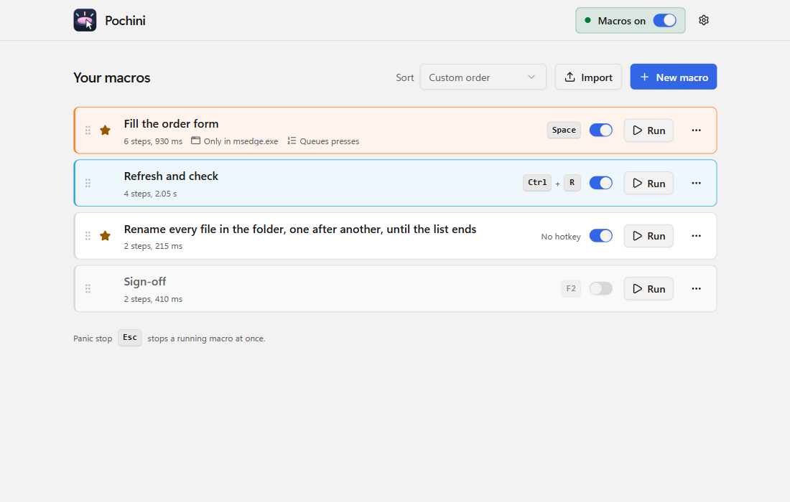
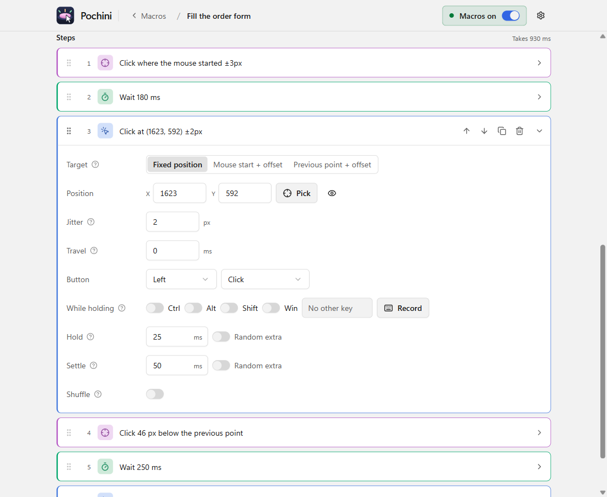

<p align="center">
  
</p>

<h1 align="center">Pochini</h1>

<p align="center">
  Click and keyboard macros for Windows, driven by screen coordinates and global hotkeys.
</p>

<p align="center">
  <a href="https://github.com/Jigglyy/pochini/releases/latest"></a>
  <a href="LICENSE"></a>
  <a href="https://github.com/Jigglyy/pochini/actions/workflows/ci.yml"></a>
</p>

<p align="center">
  <picture>
    <source media="(prefers-color-scheme: dark)" srcset="docs/images/list-dark.png">
    
  </picture>
</p>

Make a macro (click at (1920, 540), wait 500 ms give or take 200, press Shift+A, click
somewhere else), bind it to a key, and press that key to run it against whatever is on screen.
Input is sent at the operating system level, so macros work in any application: native apps,
browsers, Electron apps, emulators. The name comes from *pochi* (ぽち), the Japanese sound of
pressing a button.

## Features

- **Steps:** click at a fixed point, where the mouse was when you pressed the hotkey, an offset
  from it or from the previous click, or a point in an app's window that follows the window;
  move; press or hold keys; type text; scroll; wait; or wait until a point on screen turns a
  color.
- **Record** your clicks, keys and wheel turns in any app as steps, pauses included, or build
  them by hand. **Pick** a point by clicking it, with a magnifier.
- **Dry run** shows where every click lands by moving the mouse there, without clicking.
- **Long macros stay manageable:** lay the steps out as cards, a compact list, or a list with
  the chosen step's settings beside it. Tick several steps (every click, say) and change their
  jitter, timing or button all at once, or shift their positions when a window has moved.
- **Natural timing:** any wait or click position can vary at random within limits you set, and
  chosen steps can **shuffle** into a new order on every run.
- **Hotkeys that work everywhere**, even inside fullscreen games: run once per press, repeat
  while held, or press to start and again to stop. Presses can **queue** up behind a running
  macro, and a macro can be limited to **one app**.
- **Hold keys while clicking** (Shift, Ctrl, any key) for shift-clicks and the like, and
  **move the mouse back** to where it started when a run ends.
- **Always stoppable:** a panic key (Esc) stops any run at once, and a master switch plus a
  global on/off hotkey (Ctrl+Shift+F12) turn every hotkey off.
- **Share macros** as `.pochini.json` files. Imported macros arrive switched off, and you see
  every step before they can run.
- Drag to reorder, favorites, colors, light and dark themes, and correct clicks on every
  monitor whatever its display scaling.

<p align="center">
  <picture>
    <source media="(prefers-color-scheme: dark)" srcset="docs/images/editor-dark.png">
    
  </picture>
</p>

## Download

Pochini is a single portable `.exe` for Windows 10 and 11 (64-bit). There is nothing to install.

1. Download `Pochini-<version>.exe` from the
   [latest release](https://github.com/Jigglyy/pochini/releases/latest).
2. Run it. The exe is not code-signed yet, so Windows SmartScreen may say "Windows protected
   your PC": choose **More info**, then **Run anyway**. Some antivirus products flag it too;
   see [Privacy and antivirus](#privacy-and-antivirus) for why.

To check the download, compare its hash with `SHA256SUMS.txt` from the same release:

```powershell
Get-FileHash .\Pochini-0.11.1.exe -Algorithm SHA256
```

Pochini needs the Microsoft Edge WebView2 runtime, which Windows 11 includes and almost every
Windows 10 PC already has. To update, download the new exe; your macros stay where they are.

**Where your data lives:** `%APPDATA%\com.pochini.app` holds `macros.json` (plus `macros.bak`,
the previous save) and `settings.json`. To uninstall, delete the exe, that folder, and
`%LOCALAPPDATA%\com.pochini.app` (the window's own preferences).

## Quick start

1. **New macro**, give it a name.
2. Add steps. For a click, press **Pick** and click the spot you want (the click does not
   reach the app there), or use **Click at mouse** to click wherever the mouse is when the macro
   runs. Or press **Record steps** and just do it.
3. Under **Trigger**, press **Record** and press the key or combination to bind.
4. **Save**. Press the hotkey in any app to run the macro, and **Esc** to stop it.

**Test** in the editor runs the unsaved steps after a 3 second countdown, so you can try a
change before saving it.

## Good to know

- **Apps running as administrator** cannot receive input from a program that is not, which is
  a Windows rule. To drive one, run Pochini as administrator too.
- **Games:** Pochini works with games that accept normal Windows input. Many online games forbid
  macros in their terms of service, and some detect synthetic input. Pochini makes no attempt to
  hide (see [Scope](#scope)); whether you may use it in a game is between you and that game.
- **Hotkey not firing?** Settings > Hotkey check shows what happened the last few times you
  pressed one of your hotkeys, and only those.

## Privacy and antivirus

To notice your hotkey whatever window has focus, Pochini installs a global keyboard hook
(`WH_KEYBOARD_LL`) and sends input with `SendInput`. Keyloggers use the same Windows
features, so SmartScreen and some antivirus products are suspicious of any program that does.

- The hook compares each key with the hotkeys you set up, then lets it go. **No keystroke is
  stored, logged or sent anywhere.** The one exception is when you press **Record steps**: until
  you stop (a red banner says so), the clicks and keys you make become the macro's steps, in
  memory, and nowhere else.
- Pochini makes **no network connections**: no telemetry, no update check, no accounts.
- It lives in the tray while its window is closed, so hotkeys keep working; quit from the tray
  icon. It only starts with Windows if you turn that on.
- Exported macros leave out your window titles and monitor layout.

The source is all here to check, and [SECURITY.md](SECURITY.md) says how to report a problem.

## Building from source

You need Node 22 or newer, the Rust toolchain ([rustup](https://rustup.rs)) and the Visual
Studio C++ build tools.

```powershell
npm install
npm run tauri dev        # run it
npm run verify           # type-check, clippy, Rust tests
npm run e2e              # end-to-end tests against the real app (hidden windows)
npm run release -- current   # build release\Pochini-<version>.exe
```

Built with Tauri v2, Rust (`windows` crate), React, TypeScript, Tailwind CSS and shadcn/ui.

## Contributing

Bug reports, ideas and pull requests are welcome: see [CONTRIBUTING.md](CONTRIBUTING.md) and the
[Code of Conduct](CODE_OF_CONDUCT.md). The design notes start at [docs/](docs/), and
[CLAUDE.md](CLAUDE.md) holds the working rules for contributors, human or AI.

| | |
|---|---|
| [Overview](docs/00-overview.md) | What this is and what it deliberately isn't |
| [Architecture](docs/01-architecture.md) | Thread model, modules, testing strategy |
| [Windows input research](docs/02-windows-input-research.md) | The Win32 details that make or break it |
| [Macro format](docs/03-macro-format.md) | The JSON schema, sharing, and recovery |
| [UI spec](docs/04-ui-spec.md) | Screens and interactions |
| [Roadmap](docs/05-roadmap.md) | What is done and what is next |
| [ADRs](docs/adr/) | Why the stack is what it is |

## License

[MIT](LICENSE). Pochini includes open source software by others, listed with their licenses in
[THIRD_PARTY_NOTICES.md](THIRD_PARTY_NOTICES.md) and in Settings > About.
